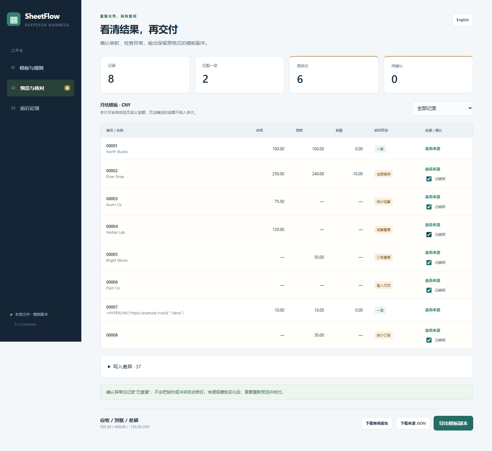

# DSH SheetFlow

**把明细填进固定 Excel 模板，逐项核对异常，每个结果都能追溯来源。**

> **财务免责声明：**SheetFlow 用于数据整理与对账复核，不提供会计、税务或财务建议，也不是记账系统。AI 映射及导出的金额、公式和异常，投入业务使用前均需独立核验。勾选“已核对”仅记录复核，不代表异常已解决或款项已获批准。

**0.1.0 本地预览版：**已在 Windows、Node 24.19.0、DSH Web 0.2.0-rc.2 上验证，提供中英文工作台。三组样例及一组新建盲测均为合成数据。真实 `deepseek-v4-pro` / `max` 识别对了列映射，但需要**修正两处来源表头行号**才能导出；这仅证明一次经复核的闭环，未证明全自动映射或真实业务兼容性。[本轮完整记录](docs/real-model-validation.md)。目前未发布 GitHub 或 npm。

[English](README.md) · [兼容性与限制](docs/compatibility.md) · [验证记录](docs/validation.md) · [规则格式](docs/recipes.md)



*演示截图：合成示例数据。*

这是 [DeepSeek Harness](https://github.com/deepseek-ai/deepseek-harness) 的独立社区插件。输入订单明细、结算明细和业务模板，确认列映射，预览写入差异，核对异常，最后得到新的模板副本、HTML 审阅报告和 JSON 来源记录。

## 已实现

- 文件、工作表、表头行、匹配编号、金额列与模板区域的可视化配置。
- 两位小数的精确金额计算；容差与分笔到账合计需要明确选择；空白金额不当作零。
- 缺订单、缺结算、重复编号、无效输入和金额差异的逐项复核。
- 文件、表名、行号、单元格、原值和规则的来源追溯。
- 保留模板单元格样式，保护公式与合并区域，预览旧值覆盖及剩余行清空。
- 保存、导入、导出可复用规则；表头变化后拒绝沿用旧映射。
- 本地会话历史；输入变化后旧审核不能继续导出；导出不覆盖原文件。
- DSH 会话提出待审规则，人工确认后执行；中英文工作台和审阅报告。

## 三步本地体验

建议 Node 24，也接受 Node 22.x 中的 22.19 及以上版本。先在解压后的源码目录运行：

```powershell
npm ci --cache .cache/npm
npm run build
npm run dev
```

打开终端给出的本地链接，点击 **载入样例规则 → 勾选确认 → 生成预览**。默认样例有 8 条记录，2 条一致，6 条异常。查看来源并逐条勾选“已核对”，再点击 **导出模板副本**。

结果保存在 `examples/month-end/` 下，包括 XLSX 副本、HTML 报告和 JSON 记录。原文件保留。本地体验不需要 Excel 或模型密钥；AI 建议功能在 DSH 内使用。

## 接入 DSH

1. 按 [官方说明](https://github.com/deepseek-ai/deepseek-harness) 安装并配置 DSH，在本项目执行上述安装、构建命令，再注册插件：

   ```powershell
   dsh plugin --profile web add "C:\Users\xiaoz\Documents\Codex\Projects\dsh-sheetflow"
   dsh web
   ```

   构建好的 `.tgz` 也可以注册，命令中的路径替换为安装包绝对路径即可。

2. 在 DSH 中选择包含来源表和模板的工作区。体验样例时，选择本项目的 `examples/month-end` 文件夹。点击 **SheetFlow 填表台**。
3. 选择来源与列，确认统一币种、业务期间、模板写入区域，生成预览，核对异常，导出副本。需要 AI 帮助时输入映射要求并发送，等待会话完成后点击 **读取建议**，再次确认再运行。

请在业务工作区的 `.gitignore` 中加入 `.dsh-sheetflow/` 和生成的 `sheetflow-*` 文件。历史和报告含业务数据。确定性处理在本地完成；点击请求 AI 建议后，指令、表头、有限样本及工具检查结果会通过当前 DSH 模型配置发送。

## 下一期复用与另一款模板

保存规则后，可在同一 DSH 会话中再次加载。跨会话通过规则 JSON 转移。换数据后仍需确认表头与业务期间，并重新生成预览、核对异常。

本地体验另一组样例：

```powershell
$env:SHEETFLOW_WORKSPACE = "examples/next-month"
npm run dev
```

通过 **高级：导入 / 导出规则 JSON** 导入该文件夹的 `recipe.json`。这组示例验证分笔到账 `0.10 + 0.20 = 0.30`。`examples/alternate-template` 则使用另一个工作表、起始行和带旧数据的模板。

## 当前边界

支持普通 XLSX 模板和 XLSX / UTF-8 逗号 CSV 明细；每份来源映射一个编号、一列金额；币种与期间由使用者确认；仅填入已有预留区域。

不计算 Excel 公式、不换汇、不做模糊匹配、多对多对账、PDF/OCR 或自动扩行。保留公式并移除旧缓存，打开导出副本后应由 Excel 重算。宏、数字签名、外部工作簿链接和受保护的目标工作表会被拒绝。复杂工作簿、远程文件系统和其他 DSH 版本尚未验证。[完整限制](docs/compatibility.md)。

开发检查：`npm run check`、`npm run test:e2e`。浏览器测试优先使用 Windows 已安装的 Google Chrome，否则执行 `npx playwright install chromium`。DSH 预发布依赖图采用 `.npmrc` 的兼容解析方式；DSH 运行程序请单独按官方说明安装。

MIT 许可。真实模型复核记录已提供；真实业务样表和复杂工作簿仍需验证，发布等待终审。
