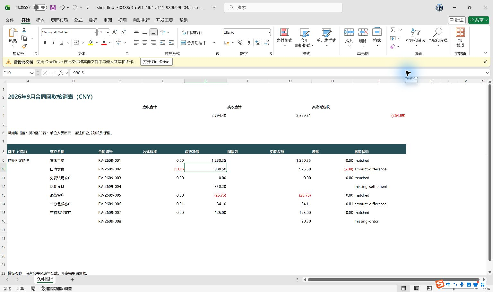
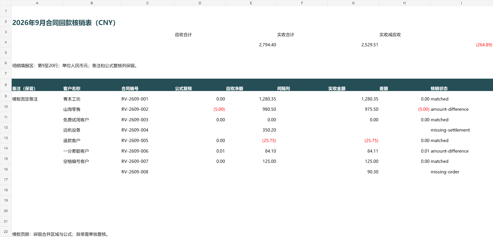

# 真实 DeepSeek 盲测与导出验收

日期：2026-10-01。测试使用新建合成数据，不含真实客户或银行数据。原生 Excel 五项检查通过，用户已明确授权 GitHub Pre-release；[发布授权记录](releases/release-approval.json)。

## 结论

真实 `deepseek-v4-pro`，`max` 推理，经 DSH Web 0.2.0-rc.2 完成文件检查和规则提交。业务列及模板映射正确，但两张来源表的表头行号各少算一行。原始规则被表头检查拒绝；复核修正两处后，8 条记录、金额计算、异常记录和三种导出结果均通过独立核对。

这是一次**需要复核修正的闭环成功**，不是模型首次全对，也不是无人值守财务验收。复核、修正、异常勾选和导出由 Codex 作为测试执行人员通过宿主 API 完成；不是用户本人手动签字。真实业务表格、复杂 Office 特性及其他模型仍未验证。

## 新数据与隔离

三份文件在本轮新建，文件名、中文表头、表头位置、列顺序和模板布局均不同于已有三个 fixture。模型工作区只包含这三份输入；独立标准答案、生成脚本和验收文件位于工作区之外，未提供给模型。这里的“未见过”指本地新建、此前未用于此插件测试；不声称能证明模型训练数据的内容。

- [合同台账](evidence/2026-10-01/contracts-sep.xlsx)：表头第 3 行，D=合同编号，C=净额应收，B=客户名称。
- [银行到账](evidence/2026-10-01/bank-sep.xlsx)：表头第 4 行，C=匹配合同，A=回款金额。
- [原始模板](evidence/2026-10-01/closeout-template.xlsx)：明细第 9–20 行；B/C/E/G/H/I 为客户、编号、应收、实收、差额、状态，D 为原有公式复核列。含合并标题、说明、页脚、汇总公式及上期旧值。

业务要求明确同为 2026 年 9 月、CNY；分笔到账求和、编号去首尾空格、大小写敏感、容差 0.00。没有让模型猜币种、期间或是否合并分笔。数据 SHA-256 见 [清单](evidence/2026-10-01/dataset-manifest.json)。

## 原始建议与复核修正

| 字段 | 模型原始建议 | 复核后 | 结果 |
| --- | --- | --- | --- |
| 合同表头 | 第 2 行 | 第 3 行 | 修正 |
| 银行表头 | 第 3 行 | 第 4 行 | 修正 |
| 来源编号 / 金额列 | D/C、C/A | 相同 | 正确 |
| 客户来源列 | B | 相同 | 正确 |
| 模板输出列 | C/B/E/G/H/I | 相同 | 正确 |
| 模板区域 | 第 9–20 行 | 相同 | 正确 |
| 分笔、空格、大小写、容差 | sum / trim / sensitive / 0.00 | 相同 | 正确 |

[模型原始规则](evidence/2026-10-01/model-proposal.json)与[修正、拒绝信息及最终规则](evidence/2026-10-01/review-corrections.json)分别保存。原建议运行被 `header-changed` 拒绝，没有写入模板。

原检查结果保留了空白样本行，但没有给每个样本标出实际行号；模型没有再次检查两张来源表的准确表头行。这是一个可复现的映射风险，不能保证只由提示造成。现在检查结果新增 `headerRow`、`sampleRows[].row`，保留空行，并要求提交前按精确行号再次检查来源表头。新增回归测试通过；**尚未再付费验证改进后的模型表现**。

## 最终金额与异常

| 编号末尾 | 应收 | 实收 | 差额 | 状态 |
| --- | ---: | ---: | ---: | --- |
| 001 | 1,280.35 | 1,280.35 | 0.00 | 一致，两笔 1,000.10 + 280.25 |
| 002 | 980.50 | 975.50 | -5.00 | 金额差异 |
| 003 | 0.00 | 0.00 | 0.00 | 零金额一致 |
| 004 | 350.20 | 空白 | 空白 | 缺到账 |
| 005 | -25.75 | -25.75 | 0.00 | 负金额一致 |
| 006 | 84.10 | 84.11 | 0.01 | 一分钱差异 |
| 007 | 125.00 | 125.00 | 0.00 | 去除编号首尾空格后一致 |
| 008 | 空白 | 90.30 | 空白 | 缺合同 |

应收合计 **2,794.40**，实收合计 **2,529.51**，实收减应收 **-264.89**。8 条记录中 4 条一致、4 条异常。四条异常均保留在导出里，勾选只允许带异常导出，未修改来源以制造平账。输入与模板的 SHA-256 前后不变。

导出：[XLSX](evidence/2026-10-01/sheetflow-5f0488c3-ca91-4fb4-a111-980b99fff04a.xlsx)、[完整审阅 HTML](evidence/2026-10-01/sheetflow-5f0488c3-ca91-4fb4-a111-980b99fff04a.html)、[JSON 来源记录](evidence/2026-10-01/sheetflow-5f0488c3-ca91-4fb4-a111-980b99fff04a.json)。[确定性结果及导出哈希](evidence/2026-10-01/workflow-result.json)。

## 真实模型耗时与用量

DSH 事件记录：08:34:13.480–08:34:48.140 UTC，单轮 **34.660 秒**。约 30.6 秒后规则可读取；测试驱动最终观测到完成约 53.7 秒，包含自身等待，不能算作模型延迟。一次用户请求、5 个模型步骤，输入 9,125 tokens，缓存读取 39,040，输出 3,712，缓存写入 0。没有从 token 数猜测实际账单金额。

调用 `sheetflow_inspect` 四次、`sheetflow_propose_recipe` 一次；模型还使用 DSH 的只读 `glob`、`pwd`，虽然测试指令要求仅用插件工具。没有调用文件写入或命令执行工具。原始三份文件哈希保持不变。工具调用和模型回复见[会话证据](evidence/2026-10-01/model-session-evidence.json)、[相关事件](evidence/2026-10-01/model-events.json)。

正式盲测前，测试驱动有两次工作区/会话选取错误。第一尝试虽点击请求按钮，但该会话记录为 0 tokens；第二尝试在提交提示前停止。正式测试加入输入文件检查后才启动模型。相关准备摩擦见[记录](evidence/2026-10-01/setup-friction.json)。浏览器运行错误记录为空。

## 导出应用验收

独立 artifact-tool 导入重算通过：汇总公式、D 列差额公式、0.01 差额、零值、负值、缺项空白、编号和固定备注均与独立标准答案相符，未检出公式错误。[机器记录](evidence/2026-10-01/independent-import.json)。这不是 Microsoft Excel 计算证明。

文件级比对另行确认：15 个原有公式表达式、198 个单元格样式、3 个合并区域以及备注和页脚保留；6 个未修改的 ZIP 部件逐字节相同。公式缓存全部移除，以请求应用重算。[保留检查](evidence/2026-10-01/preservation-check.json)。这也不代替原生应用验收。

PM 原先要求用户按照[发布前人工验收指引](manual-excel-check.md)手动检查。2026-10-01，用户随后明确委托 Codex 使用电脑插件完成这五项。此次只操作指定合成文件的 Microsoft Excel 原生界面，未使用加载项。应用版本 16.0.20326.20158，以只读方式打开；“只读”仍允许内存中的临时改值和原生公式重算。

1. `Ctrl+Alt+F9` 强制重算后，E4 **2,794.40**、G4 **2,529.51**、I4 **−264.89**，汇总与明细未见公式错误。
2. 逐个点击 A2、A6、A22，原生选区均跨 A:I，合并按钮显示选中；标题、说明和页脚文字完整。
3. D10 公式栏为 `=IF(AND(ISNUMBER(E10),ISNUMBER(G10)),G10-E10,"")`。将 E10 临时改为 **981.50** 后，D10 由 **−5.00** 变为 **−6.00**，E4 变为 **2,795.40**；立即 `Ctrl+Z` 撤销，三处均恢复原值。
4. 第 9–16 行合同编号、金额、空白和状态逐格与上表一致，四条异常保留。千分位、小数位、负数红色括号和表头格式正常显示。
5. A9 固定备注和 A22:I22 合并页脚保留。关闭时选择“不保存”；导出文件 SHA-256 检查前后同为 `A45922186789960309D986B00E35ADDE1C9E224184F0DAFF6B42DFC79FC6FBBC`。

[原生验收记录及 7 张截图](evidence/2026-10-01/excel-verification.json) · [仅工作表单元格的原生 UI 读取记录](evidence/2026-10-01/excel-ui-observations.json)。编辑过程中 Excel 的辅助功能文字有一帧延迟，临时 −6.00 结果以实际原生截图为准；UIA 直接设值未提交，最终通过 F2 编辑、输入、回车完成测试。

这是 **Codex 按用户委托代操作的 Excel 验收**，不能写成用户本人手动签字。五项已通过；用户于本次发布请求明确回复 **“Excel 检查通过，同意发布”**，授权建仓、推送并发布 GitHub Pre-release。

*原生 Microsoft Excel 截图；合成示例数据，Codex 代操作。临时改值及撤销截图分别见 07-excel-changed.jpg、08-excel-restored.jpg。*

*演示截图：合成示例数据；由 artifact-tool 渲染，不是 Excel 原生截图。*

## 交付检查与限制

严格 TypeScript 检查、26 项核心测试、3 项浏览器测试、生产构建通过。新回归覆盖空白行上方标题、实际表头行号和样本绝对行号。真实模型测试使用改进前安装包；改进后代码经过上述自动检查，尚未增加真实 API 调用。

README 中英版本顶部已加财务免责声明，演示截图注明合成示例数据。用户明确回复“Excel 检查通过，同意发布”，放行 `dsh-sheetflow` 建仓、push main 和 `v0.1.0-pre` GitHub Pre-release。此授权不等同用户本人操作 Excel 或财务签字。本次不发布 npm。凭据、启动访问令牌、DSH 私有配置、会话存储和工作目录不放进交付证据。
